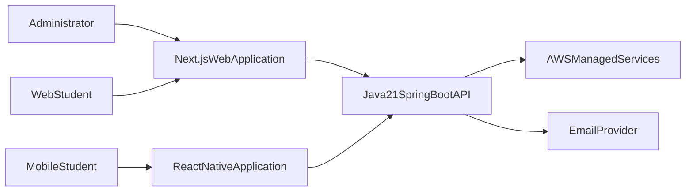
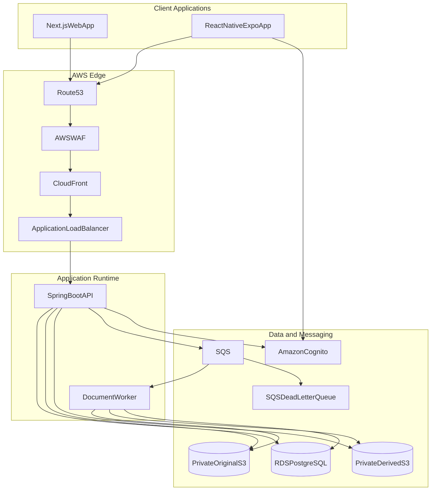
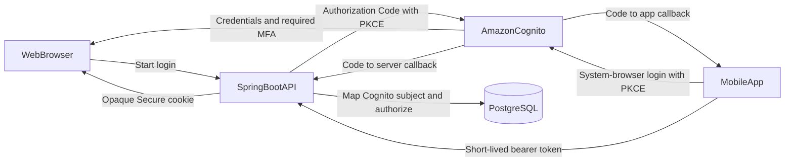
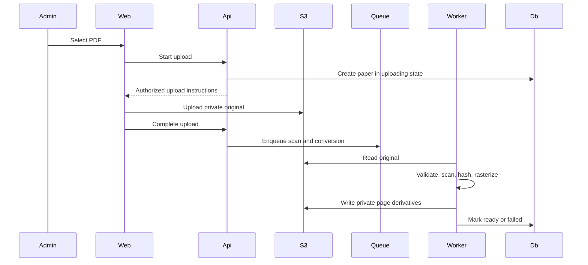
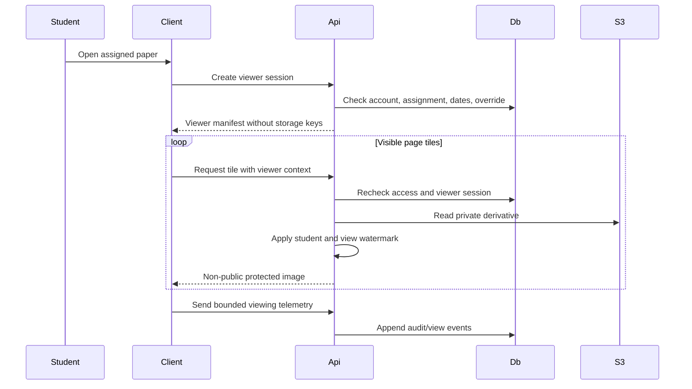

# High-Level Design — Secure Coaching Content Portal

## 1. Purpose and status

This HLD defines the architecture selected to satisfy `implementation-plan-nishant-tution.md`. It covers the web application, Android/iOS application, Java backend, document-processing pipeline, AWS infrastructure, security boundaries, and operational design.

Status: Proposed for approval before implementation.

## 2. Architecture decisions

- Use a modular monolith for the first release.
- Use Java 21 and Spring Boot 4.1 for the backend. Pin the latest 4.1 patch available when implementation starts.
- Use Next.js with TypeScript for the administrator and student web application.
- Use React Native with Expo development builds and TypeScript for the Android/iOS student application.
- Publish a versioned REST API described by OpenAPI.
- Keep all business authorization in the Java backend.
- Use Amazon Cognito User Pools as the identity provider with OpenID Connect over OAuth 2 Authorization Code with PKCE.
- Use PostgreSQL as the system of record.
- Store original PDFs and generated derivatives in private Amazon S3 buckets.
- Process uploaded documents asynchronously using Amazon SQS and a Java worker.
- Deliver server-watermarked page images or tiles, never original PDFs, to student clients.
- Use Spring-managed opaque web sessions backed by Cognito OIDC tokens; use short-lived Cognito access tokens and rotating managed refresh credentials for mobile.
- Deploy initially for one institute while retaining an organization ownership boundary in data and authorization.
- Do not require Redis in the MVP. Add it only after measured need.

## 3. Context

## 4. Logical architecture

CloudFront may cache public web assets. Protected page responses must use a design that prevents cross-user cache leakage. Private originals and unwatermarked derivatives are never publicly addressable.

## 5. Backend modules

The Spring Boot application is one deployable unit with explicit internal modules:

- Cognito identity federation, local user mapping, and web session management
- Users, roles, and permissions
- Organizations and branding
- Batches and memberships
- Subjects and papers
- Assignments and access overrides
- Document upload and processing coordination
- Protected viewer authorization and watermark delivery
- Audit and basic reporting
- Notification abstraction
- Operational health and administration

Module boundaries must prevent direct cross-module persistence access. Modules interact through application services, stable interfaces, and domain events where useful.

## 6. Client applications

### 6.1 Next.js web application

- Administrator console: all MVP administration.
- Student portal: dashboard, protected viewer, profile, and sessions.
- Server-rendered public/login shell where beneficial.
- Authenticated API calls remain same-origin from the browser through the deployed routing layer.
- The web application contains presentation and interaction logic only; it does not make authorization decisions.

### 6.2 React Native mobile application

- Student-only Android and iOS experience.
- Shared TypeScript domain/API package where practical, but no requirement to share UI components with Next.js.
- Expo development builds permit native screenshot/capture controls, secure storage, crash reporting, and store builds.
- No offline protected-paper mode.
- Protected imagery is held transiently and is not intentionally exported to photos, files, or user-accessible storage.

## 7. Principal workflows

### 7.1 Authentication

For web, Spring performs the code exchange and keeps Cognito tokens server-side; the browser receives only a Secure, HttpOnly opaque session cookie. Mobile uses the operating-system browser and PKCE, stores the managed refresh credential in Keychain/Keystore, and sends short-lived access tokens to the API.

### 7.2 Paper ingestion

The exact upload mechanism may use an API stream or tightly scoped pre-signed upload. Any pre-signed upload is for administrators only, short-lived, constrained to a generated object key, and followed by trusted validation.

### 7.3 Protected viewing

No client receives the original PDF or an unwatermarked derivative URL.

## 8. Data architecture

PostgreSQL is authoritative for:

- Organization and branding configuration
- Cognito subject mappings, application account status, roles, and permissions
- Web sessions and security/session revocation records
- Batches and memberships
- Subjects, papers, versions, and processing state
- Assignments and individual access overrides
- Viewer sessions
- Administrative audit events and viewing events
- Transactional job/outbox state where required

S3 is authoritative for:

- Quarantined uploads
- Validated original PDFs
- Private unwatermarked page derivatives
- Processing outputs and temporary artifacts governed by lifecycle rules

Object keys are opaque and never used as authorization. Database identifiers use UUIDs. All organization-owned records include an organization ownership boundary even though the MVP has one organization.

## 9. Security architecture

### 9.1 Trust boundaries

- User devices and browsers are untrusted.
- Next.js and React Native clients are untrusted for authorization.
- The internet/edge boundary is protected by TLS, WAF rules, and rate limits.
- The Spring Boot API is the policy-enforcement point.
- The worker processes hostile uploaded files in a restricted environment.
- Database, S3, SQS, and secrets are private managed resources with least-privilege IAM.

### 9.2 Authentication

- Amazon Cognito stores and verifies passwords and manages invitation, reset, and TOTP MFA flows.
- Both clients use OIDC Authorization Code with PKCE against the approved Cognito user pool and domain.
- Spring Security validates token signature, issuer, audience/client, expiry, and required token use.
- Web uses a Spring-managed opaque, revocable session in a Secure, HttpOnly, SameSite cookie; Cognito tokens remain server-side.
- State-changing web requests use CSRF protection.
- Mobile access tokens are short-lived and never stored in general application storage.
- Mobile refresh credentials are managed through Cognito and stored only in Keychain/Keystore.
- Administrator membership requires TOTP MFA; the backend also rejects administrator access when the required assurance claim/policy is absent.
- Local users map to immutable Cognito `sub` identifiers; email is not used as the identity key.
- Local account disablement and authorization remain effective even while an issued token has not expired.

### 9.3 Authorization

- Endpoint role checks are necessary but not sufficient.
- Every resource access checks organization ownership and object relationship.
- Protected viewing evaluates the effective assignment, dates, account state, processing state, and overrides.
- Revocation and expiry are checked synchronously.
- Administrative actions require explicit permissions to support future roles.

### 9.4 Document security

- Original PDF and derivatives use separate private prefixes or buckets and IAM policies.
- The conversion worker cannot administer users or assignments.
- The API reads only the derivatives required for an authorized request.
- Watermarking occurs before bytes leave the trusted backend boundary.
- Responses prohibit shared caching and use conservative local caching directives.
- Viewer manifests never contain S3 keys.
- Random identifiers are not treated as access control.

### 9.5 Mobile capture deterrence

- Android enables secure-window behavior on protected screens where supported.
- iOS monitors capture/mirroring signals and obscures protected content where feasible.
- App-switcher snapshots are obscured on both platforms.
- Visible watermarking remains mandatory.
- Root/jailbreak signals may be recorded or used for policy only after product and false-positive review.

### 9.6 Audit

- Security-relevant events use structured append-only application behavior.
- Records identify actor, action, target, outcome, timestamp, request correlation, and appropriate client metadata.
- Logs exclude passwords, reset tokens, MFA secrets, access tokens, refresh tokens, and document content.
- Cloud and database controls restrict audit mutation.

## 10. Deployment architecture

Recommended MVP deployment:

- Route 53 for DNS.
- ACM-managed TLS certificates.
- AWS WAF and CloudFront at the edge.
- Application Load Balancer in front of private application tasks.
- ECS Fargate for the Spring Boot API and document worker. App Runner may be evaluated, but one runtime pattern should be selected before build.
- Next.js deployed either to ECS in the same AWS environment or to a separately approved managed frontend service. Same-origin browser routing must be preserved.
- RDS PostgreSQL in private subnets with automated backups.
- Private S3 buckets with public access blocked.
- SQS plus dead-letter queue for document processing.
- AWS Secrets Manager or Parameter Store for runtime secrets.
- Amazon Cognito User Pools with an approved managed-login domain and per-client configuration.
- CloudWatch logs, metrics, dashboards, and alarms.
- SES or another approved provider for invitations and resets.

Development, test/staging, and production are isolated environments. Production credentials and data must never be copied into lower environments.

## 11. Reliability and consistency

- Database changes are transactional.
- Queue publication that depends on a database change uses an outbox or an equivalent consistency pattern.
- Worker operations are idempotent.
- Each paper version has immutable source and derivative identity.
- Processing retries use bounded exponential backoff and dead-letter handling.
- A paper becomes ready only after all mandatory outputs are verified.
- Viewer authorization fails closed when dependencies are unavailable.
- Health checks distinguish process health from dependency readiness.

## 12. Performance and scaling

- Stateless API tasks scale horizontally.
- Worker concurrency scales independently from API traffic.
- Page derivatives are generated once; user-specific watermarking occurs on authorized delivery.
- Common unwatermarked source derivatives may be held in bounded server memory only if the security review approves it.
- The viewer progressively requests the current and adjacent page tiles.
- Load tests must cover 100 concurrent viewers, login spikes, batch assignment, uploads, and worker backlogs.
- Redis, pre-generated user derivatives, or an image-processing tier are optimization options only after profiling.

## 13. Observability

- Every request and background job receives a correlation identifier.
- Metrics cover authentication outcomes, API latency/errors, access denials, active viewer sessions, SQS depth/age, conversion duration/failures, database health, and S3 errors.
- Alerts must identify actionable conditions and link to runbooks.
- Mobile and web error reporting must remove secrets and protected content.
- Product analytics must be separated from security/audit records.

## 14. Backup and disaster recovery

- Enable automated RDS backups and point-in-time recovery according to approved retention.
- Enable S3 versioning or an approved recovery policy for required objects.
- Protect infrastructure definitions and database migrations in version control.
- Test database and required-object restoration before production and on an agreed schedule.
- Record approved RPO and RTO in the requirements sign-off.

## 15. Environments and delivery

- Local development uses emulated or isolated dependencies and synthetic content.
- CI runs formatting, linting, unit tests, dependency checks, secret scanning, and builds.
- Staging mirrors production security boundaries with reduced capacity.
- Infrastructure changes use reviewed infrastructure-as-code.
- Database migrations are forward-controlled and rehearsed in staging.
- Android and iOS use development, internal/beta, and production release channels.
- Production rollout includes rollback criteria and smoke tests.

## 16. Key risks and mitigations

- Screenshot prevention cannot be guaranteed: use visible forensic watermarks and accurate customer messaging.
- Dynamic image watermarking may be CPU intensive: benchmark early and scale the delivery tier independently if needed.
- PDF parsing is a hostile-file risk: isolate workers, scan inputs, impose limits, patch libraries, and restrict IAM/network access.
- Mobile platform behavior differs: test protected-screen behavior on real devices and document limitations.
- Cognito and local account state can drift: use immutable subject mapping, compensating administration workflows, reconciliation, and a local active-status check on every request.
- Future role growth can cause scattered checks: use explicit permissions and centralized authorization.
- Premature multi-tenancy increases risk: retain ownership boundaries but defer multi-tenant operations and custom domains.

## 17. Deferred architecture

The following are deliberately deferred:

- Multi-tenant control plane and self-service organization onboarding
- Custom-domain automation
- Instructor workflows
- Advanced analytics warehouse
- Push notifications
- Offline encrypted document packages
- Redis caching
- Migration to a different OIDC identity provider
- Multi-region active-active deployment

## 18. Approval gates

Implementation should begin only after:

- Customer requirements and open items are signed off.
- Threat model and viewer proof-of-concept are reviewed.
- Watermark quality and conversion benchmark are accepted.
- AWS deployment pattern and cost estimate are approved.
- API/session design is approved for web and mobile.
- Browser, OS/device, accessibility, retention, availability, RPO, and RTO targets are recorded.
