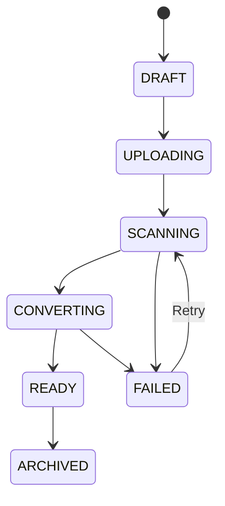
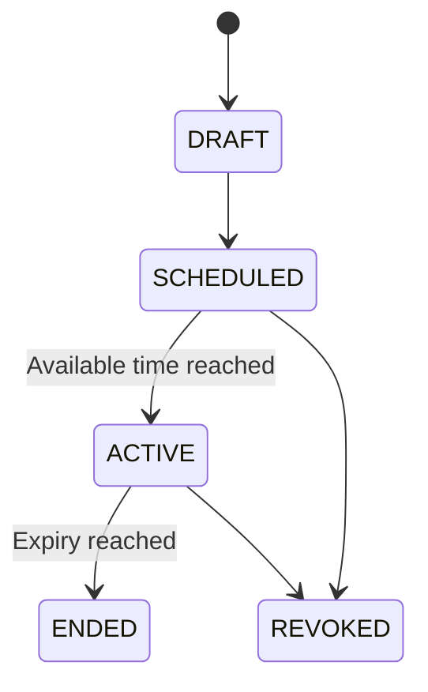

# Low-Level Design — Secure Coaching Content Portal

## 1. Purpose

This LLD translates `HLD.md` and `implementation-plan-nishant-tution.md` into implementable component boundaries, data structures, API behavior, workflows, and verification criteria. Exact library versions, limits, and timing values must be pinned during project setup and recorded through architecture decisions.

## 2. Repository and deployable layout

Recommended monorepo:

```text
/
  apps/
    web/                  Next.js TypeScript application
    mobile/               React Native Expo application
    api/                  Java 21 Spring Boot API
    document-worker/      Java 21 asynchronous worker
  packages/
    api-client/           Generated TypeScript OpenAPI client
    shared-types/         Client-only shared types and validation helpers
    design-tokens/        Approved branding tokens
  infrastructure/
    environments/         Environment-specific IaC composition
    modules/              Reusable AWS IaC modules
  docs/
    adr/                  Architecture decision records
    runbooks/             Operational procedures
```

The API and worker may share Java domain libraries, but neither client imports backend domain code.

## 3. Backend internal structure

Use package-by-feature with enforced module boundaries:

```text
com.coachingportal
  identity
  organization
  user
  authorization
  batch
  subject
  paper
  assignment
  viewer
  audit
  notification
  shared
```

Each feature contains, as needed:

- `api`: controllers and transport DTOs
- `application`: use cases and transaction boundaries
- `domain`: entities, value objects, policies, and domain events
- `infrastructure`: repositories and external adapters

Rules:

- Controllers do not access repositories directly.
- Persistence entities are not serialized as API responses.
- Cross-module calls use application interfaces.
- Domain policies do not depend on HTTP, S3, or framework classes.
- Security checks occur at the application boundary and again in resource-specific policies.

## 4. Data model

All primary identifiers are UUIDs. All timestamps are UTC instants. Mutable tables include creation/update metadata and optimistic-lock version where concurrent updates matter.

### 4.1 Organization and branding

`organizations`

- `id`
- `name`
- `slug`
- `timezone`
- `status`
- `created_at`
- `updated_at`

`organization_branding`

- `organization_id`
- `logo_object_key`
- `favicon_object_key`
- `primary_color`
- `secondary_color`
- `footer_text`
- `mobile_app_name`
- `version`
- `updated_by`
- `updated_at`

Although only one organization is active initially, all organization-owned domain records carry `organization_id`.

### 4.2 Identity, roles, and sessions

`users`

- `id`
- `organization_id`
- `cognito_subject`
- `email_normalized`
- `email_display`
- `name`
- `student_reference`
- `status`: `INVITED`, `ACTIVE`, `LOCKED`, `DISABLED`
- `last_login_at`
- `created_at`
- `updated_at`
- unique `cognito_subject`
- unique `(organization_id, email_normalized)`
- unique nullable `(organization_id, student_reference)`

`external_identity_events`

- `id`
- `user_id`
- `provider`: `COGNITO`
- `event_type`
- `provider_event_id`
- `occurred_at`
- `processed_at`
- unique `(provider, provider_event_id)`

`roles`

- `id`
- `organization_id` nullable for system templates
- `code`
- `name`
- unique `(organization_id, code)`

`permissions`

- `id`
- `code`
- `description`

`user_roles`

- `user_id`
- `role_id`
- composite primary key

`role_permissions`

- `role_id`
- `permission_id`
- composite primary key

Seed `ADMIN` and `STUDENT`; authorization uses permission codes rather than hard-coded role comparisons where practical.

`web_sessions`

- `id`
- `user_id`
- `secret_hash`
- `cognito_subject`
- `authorized_client_ciphertext`
- `created_at`
- `last_seen_at`
- `idle_expires_at`
- `absolute_expires_at`
- `revoked_at`
- `revocation_reason`
- `ip_created`
- `user_agent_created`

`client_sessions`

- `id`
- `user_id`
- `client_type`: `WEB`, `ANDROID`, `IOS`
- `device_id_hash`
- `provider_session_id`
- `created_at`
- `last_seen_at`
- `expires_at`
- `revoked_at`
- `device_label`
- unique `(user_id, provider_session_id)`

Amazon Cognito stores passwords, MFA factors, invitation/reset state, and mobile refresh credentials. Web OIDC tokens are encrypted server-side as authorized-client data. Raw tokens and Cognito secrets are never logged or stored in general user/session columns.

### 4.3 Coaching structure

`batches`

- `id`
- `organization_id`
- `name`
- `description`
- `start_date`
- `end_date`
- `status`
- `created_by`
- `created_at`
- `updated_at`

`batch_memberships`

- `id`
- `organization_id`
- `batch_id`
- `user_id`
- `joined_at`
- `left_at`
- `created_by`
- only one active membership for a user/batch pair

`subjects`

- `id`
- `organization_id`
- `name`
- `code`
- `status`
- unique `(organization_id, code)`

### 4.4 Papers and processing

`papers`

- `id`
- `organization_id`
- `subject_id`
- `title`
- `description`
- `status`: `DRAFT`, `UPLOADING`, `SCANNING`, `CONVERTING`, `READY`, `FAILED`, `ARCHIVED`
- `current_version_id`
- `uploaded_by`
- `created_at`
- `updated_at`

`paper_versions`

- `id`
- `paper_id`
- `version_number`
- `original_object_key`
- `sha256`
- `media_type`
- `size_bytes`
- `page_count`
- `processing_error_code`
- `processing_error_detail_safe`
- `created_at`
- unique `(paper_id, version_number)`

`paper_pages`

- `id`
- `paper_version_id`
- `page_number`
- `width`
- `height`
- `tile_size`
- `tile_levels`
- `manifest_object_key`
- unique `(paper_version_id, page_number)`

`document_jobs`

- `id`
- `paper_version_id`
- `type`: `SCAN`, `VALIDATE`, `CONVERT`, `CLEANUP`
- `status`: `PENDING`, `RUNNING`, `SUCCEEDED`, `FAILED`, `DEAD_LETTERED`
- `attempt`
- `idempotency_key`
- `started_at`
- `completed_at`
- `error_code`
- unique `idempotency_key`

### 4.5 Assignment and access

`assignments`

- `id`
- `organization_id`
- `paper_id`
- `batch_id`
- `available_from`
- `expires_at`
- `status`: `DRAFT`, `SCHEDULED`, `ACTIVE`, `REVOKED`, `ENDED`
- `assigned_by`
- `created_at`
- `updated_at`
- check `expires_at > available_from`

`access_overrides`

- `id`
- `organization_id`
- `assignment_id`
- `user_id`
- `type`: `GRANT`, `EXTEND`, `REVOKE`, `RESTORE`
- `effective_from`
- `expires_at`
- `reason`
- `created_by`
- `created_at`

Overrides are append-only. Effective access is computed from membership, assignment, account state, and the latest applicable authorized override.

### 4.6 Viewer and audit

`viewer_sessions`

- `id`
- `organization_id`
- `user_id`
- `paper_id`
- `paper_version_id`
- `assignment_id`
- `client_type`: `WEB`, `ANDROID`, `IOS`
- `watermark_seed`
- `created_at`
- `last_seen_at`
- `expires_at`
- `revoked_at`

`view_events`

- `id`
- `organization_id`
- `viewer_session_id`
- `user_id`
- `paper_id`
- `assignment_id`
- `event_type`: `OPENED`, `PAGE_REQUESTED`, `HEARTBEAT`, `CLOSED`, `DENIED`, `CAPTURE_DETECTED`
- `page_number` nullable
- `occurred_at`
- `request_id`
- `ip_address` subject to retention policy
- `user_agent_or_app_version`
- `metadata_json` allowlisted and size-bounded

High-frequency page telemetry may be sampled or aggregated, but open, denial, revocation, and capture events remain durable.

`audit_events`

- `id`
- `organization_id`
- `actor_user_id`
- `action`
- `target_type`
- `target_id`
- `outcome`
- `reason`
- `request_id`
- `before_json` redacted and allowlisted
- `after_json` redacted and allowlisted
- `occurred_at`

Normal application code has no update/delete operation for audit events.

## 5. Access policy algorithm

Input: authenticated user, requested paper, current time.

1. Require active user and matching organization.
2. Require paper status `READY` and a current ready version.
3. Locate candidate assignments for active batch memberships.
4. Require an assignment whose status permits access.
5. Require current time within assignment availability.
6. Apply relevant individual overrides in deterministic chronological order.
7. Deny if the effective result is revoked or expired.
8. Return a compact access decision containing assignment, paper version, effective expiry, and policy reason code.

The policy returns internal reason codes. Controllers map them to safe client errors:

- `PAPER_NOT_READY`
- `NOT_ASSIGNED`
- `NOT_YET_AVAILABLE`
- `ACCESS_EXPIRED`
- `ACCESS_REVOKED`
- `ACCOUNT_DISABLED`

No denial reveals another user, batch, storage key, or unpublished paper.

## 6. API conventions

- Base path: `/api/v1`
- JSON uses UTF-8 and camelCase.
- Timestamps use ISO-8601 UTC.
- List endpoints use cursor pagination where records may grow substantially.
- Mutation requests support an idempotency key where retries could duplicate work.
- Validation errors identify safe field paths.
- Every response includes or echoes a request/correlation identifier.
- OpenAPI is authoritative for request and response contracts.
- Breaking changes require a new API version or a migration-compatible rollout.

Standard error envelope:

```json
{
  "code": "ACCESS_EXPIRED",
  "message": "This paper is no longer available.",
  "requestId": "uuid",
  "fieldErrors": []
}
```

Stack traces and internal exception messages never appear in production responses.

## 7. Authentication APIs

Web:

- `GET /api/v1/auth/web/login` — start Cognito OIDC Authorization Code with PKCE
- `GET /login/oauth2/code/cognito` — framework-managed callback
- `POST /api/v1/auth/web/logout`
- `GET /api/v1/auth/session`

Mobile:

- Mobile starts Cognito OIDC Authorization Code with PKCE in the operating-system browser.
- Token exchange, refresh rotation, revocation, invitation acceptance, password reset, and MFA are Cognito endpoints/managed-login journeys rather than application password APIs.
- `POST /api/v1/auth/mobile/session` — register or refresh local device/session metadata after successful OIDC authentication.
- `POST /api/v1/auth/mobile/logout` — revoke local application session; client also invokes Cognito token revocation.
- `POST /api/v1/auth/mobile/logout-all` — revoke all local sessions and invoke Cognito global sign-out through an authorized backend integration.

Security behavior:

- Use separate Cognito app clients for web and mobile with no embedded client secret in public clients.
- Redirect URIs and logout URIs are exact allowlists for each environment.
- Require Authorization Code and PKCE; implicit flow is disabled.
- Validate token signature, issuer, audience/client identifier, expiry, token use, and required scopes.
- Map identity only by immutable Cognito `sub`.
- Cognito managed login provides account-enumeration resistance, password policy, invitation/reset, and MFA behavior.
- Administrator application access requires local admin permission and the approved MFA assurance.
- Web authentication rotates the local opaque session identifier and stores Cognito authorized-client data encrypted server-side.
- Enable Cognito refresh-token rotation and token revocation for mobile.
- Every API request checks local account status, so disabling a user takes effect before an existing Cognito token expires.
- Logout is idempotent.

## 8. Administration APIs

Users:

- `GET /api/v1/admin/users`
- `POST /api/v1/admin/users`
- `GET /api/v1/admin/users/{userId}`
- `PATCH /api/v1/admin/users/{userId}`
- `POST /api/v1/admin/users/imports`
- `GET /api/v1/admin/users/imports/{importId}`
- `POST /api/v1/admin/users/{userId}/sessions/revoke` — revoke local sessions and perform Cognito global sign-out

Batches:

- `GET /api/v1/admin/batches`
- `POST /api/v1/admin/batches`
- `GET /api/v1/admin/batches/{batchId}`
- `PATCH /api/v1/admin/batches/{batchId}`
- `POST /api/v1/admin/batches/{batchId}/members`
- `DELETE /api/v1/admin/batches/{batchId}/members/{userId}`

Subjects and papers:

- `GET /api/v1/admin/subjects`
- `POST /api/v1/admin/subjects`
- `PATCH /api/v1/admin/subjects/{subjectId}`
- `POST /api/v1/admin/papers`
- `POST /api/v1/admin/papers/{paperId}/upload-init`
- `POST /api/v1/admin/papers/{paperId}/upload-complete`
- `GET /api/v1/admin/papers`
- `GET /api/v1/admin/papers/{paperId}`
- `POST /api/v1/admin/papers/{paperId}/archive`
- `POST /api/v1/admin/papers/{paperId}/retry-processing`

Assignments:

- `GET /api/v1/admin/assignments`
- `POST /api/v1/admin/assignments`
- `GET /api/v1/admin/assignments/{assignmentId}`
- `PATCH /api/v1/admin/assignments/{assignmentId}`
- `POST /api/v1/admin/assignments/{assignmentId}/revoke`
- `POST /api/v1/admin/assignments/{assignmentId}/overrides`

Audit and branding:

- `GET /api/v1/admin/audit-events`
- `GET /api/v1/admin/view-events`
- `GET /api/v1/admin/branding`
- `PATCH /api/v1/admin/branding`

Every endpoint defines required permission codes and organization/resource checks in OpenAPI and tests.

## 9. Student and viewer APIs

Student:

- `GET /api/v1/student/me`
- `GET /api/v1/student/sessions`
- `DELETE /api/v1/student/sessions/{sessionId}`
- `GET /api/v1/student/papers?state=active|upcoming|expired`
- `GET /api/v1/student/papers/{paperId}`

Viewer:

- `POST /api/v1/student/papers/{paperId}/viewer-sessions`
- `GET /api/v1/viewer-sessions/{viewerSessionId}/manifest`
- `GET /api/v1/viewer-sessions/{viewerSessionId}/pages/{page}/tiles/{level}/{x}/{y}`
- `POST /api/v1/viewer-sessions/{viewerSessionId}/events`
- `DELETE /api/v1/viewer-sessions/{viewerSessionId}`

Viewer-session creation returns:

- Opaque viewer session identifier
- Paper title and page count
- Tile geometry and supported levels
- Effective expiry
- Watermark display policy identifier
- Short viewer-session expiry

It does not return S3 keys or reusable storage URLs.

## 10. Protected tile generation

1. Authenticate the client.
2. Load viewer session by opaque identifier.
3. Require viewer ownership and matching organization.
4. Reject expired or revoked viewer session.
5. Re-evaluate paper access at a bounded interval and on security-sensitive events; tile requests always enforce session expiry and revocation.
6. Validate page, level, and tile coordinates against trusted metadata.
7. Load the private base derivative using server IAM.
8. Render repeated watermark text using the viewer watermark seed and approved policy.
9. Encode the final tile in the approved image format.
10. Return headers preventing shared storage and unsafe content interpretation.
11. Record bounded viewing telemetry.

Watermark content:

- Student display name
- Masked or full email according to approved privacy policy
- Student reference
- Short view/session marker

Watermark placement is deterministic per viewer session but varies between sessions. Opacity, density, font sizing, and contrast are bounded by an approved configuration.

Do not cache watermarked output across users. Any per-session cache must be short-lived, bounded, inaccessible outside the API, and invalidated on revocation.

## 11. Document worker

### 11.1 Job stages

1. Claim message and verify idempotency state.
2. Move upload into quarantine processing.
3. Verify declared size and media type.
4. Perform malware scan.
5. Parse PDF under page, dimension, complexity, and execution-time limits.
6. Compute SHA-256 and extract safe page metadata.
7. Rasterize each page at approved base resolutions.
8. Produce tiles and manifests in private derived storage.
9. Verify expected outputs.
10. Transactionally mark the version ready and publish an audit/domain event.
11. Remove temporary artifacts.

Failure marks the paper version failed with a safe administrator-visible code. Partial derivatives are never published as ready.

### 11.2 Worker isolation

- Separate task role from API.
- No inbound public network.
- Restricted outbound access.
- Read only its queued source object and write only its generated prefix.
- Resource and execution limits.
- Temporary storage encrypted and cleared.
- PDF and image libraries included in patch monitoring.

### 11.3 Idempotency

The idempotency key includes paper version and processing stage. Re-delivery:

- Returns success if verified output already exists.
- Continues from an approved checkpoint or clears incomplete output.
- Never increments paper version.
- Never makes a failed partial version ready.

## 12. Web application design

Route groups:

```text
/(public)/login
/(public)/forgot-password
/(public)/reset-password
/(admin)/admin/users
/(admin)/admin/batches
/(admin)/admin/subjects
/(admin)/admin/papers
/(admin)/admin/assignments
/(admin)/admin/audit
/(student)/papers
/(student)/papers/[paperId]
/(student)/viewer/[viewerSessionId]
/(student)/profile
```

Web rules:

- Server middleware may provide coarse navigation guards, but the API remains authoritative.
- No protected data is embedded into cacheable public pages.
- State-changing requests carry CSRF protection.
- Protected viewer pages disable print content and obvious browser actions as deterrence only.
- App-switching/tab visibility may obscure content when product-approved.
- Accessibility includes keyboard navigation outside prohibited print/save behavior, focus management, labels, and status announcements.

## 13. Mobile application design

Navigation:

```text
Root
  Bootstrap
  SignedOut
    Login
    ForgotPassword
  SignedIn
    PaperTabs
      Active
      Upcoming
      Expired
    PaperDetails
    ProtectedViewer
    Profile
    Sessions
```

State boundaries:

- Authentication state and token rotation
- Current user/profile
- Paper list/query cache
- Viewer state
- Network and application lifecycle

Mobile rules:

- Use the operating-system browser and Cognito OIDC Authorization Code with PKCE; do not embed a web view for credentials.
- Store the Cognito refresh credential in Keychain/Keystore through an approved secure-storage adapter.
- Hold access token in memory; avoid general persistent state stores.
- Serialize refresh attempts and use Cognito refresh-token rotation.
- Clear credentials and protected caches on revocation, logout, global sign-out, or user change.
- Do not take screenshots for diagnostics on protected screens.
- Obscure app-switcher preview.
- Enable Android secure-window behavior while viewer is active.
- On iOS capture detection, obscure content and emit a bounded event according to approved UX.
- Do not rely on certificate pinning unless an operational rotation strategy is approved.
- Deep links never include credentials or storage keys.
- Crash reports exclude viewer pixels, tokens, and sensitive API payloads.

## 14. State machines

Paper:



Assignment:



Authorization must use timestamps directly even if an asynchronous status update has not yet run.

## 15. Transactions and concurrency

- User email uniqueness is enforced by the database.
- Membership add/remove is idempotent.
- Assignment mutations use optimistic locking.
- Paper readiness and current-version updates occur in one transaction after output verification.
- Cognito refresh-token rotation is enabled; local session registration/revocation uses conditional updates keyed by the provider session identifier.
- Audit event creation occurs in the same transaction as critical administrative changes or through a transactional outbox.
- API retry keys are scoped to actor, endpoint, and request purpose.

## 16. Validation and limits

Values requiring sign-off:

- Maximum PDF bytes
- Maximum pages
- Maximum raster dimensions
- Conversion timeout and worker memory
- CSV row and file limits
- Search/filter length
- Viewer session duration
- Web idle and absolute session duration
- Mobile access and refresh duration
- Login/reset rate limits
- Telemetry event batch size

All limits are enforced server-side. Client checks improve usability only.

## 17. Logging and telemetry

Required context:

- Request identifier
- Trace identifier where enabled
- Authenticated user ID after authentication
- Organization ID
- Client type and safe version
- Endpoint or job type
- Outcome and duration

Forbidden log content:

- Passwords
- MFA secrets or complete codes
- Session, access, refresh, invitation, or reset tokens
- Full protected page contents
- S3 signed URLs
- Unbounded request/response bodies

IP addresses and device metadata follow approved privacy and retention policy.

## 18. Database migrations

- Use one migration tool and immutable versioned migrations.
- CI applies migrations to a clean database.
- Staging rehearses production migrations.
- Destructive schema changes use expand/migrate/contract.
- Application deployment remains compatible through rolling updates.
- Seed only non-secret reference data and role/permission definitions.

## 19. Testing strategy

Backend:

- Domain unit tests for access policy and state transitions
- Application tests for transaction and permission behavior
- Repository integration tests against PostgreSQL
- S3/SQS adapter tests
- API contract and authorization tests
- Worker tests with benign, malformed, oversized, encrypted, and malicious test PDFs

Web:

- Component and accessibility tests
- API-client contract tests
- End-to-end administrator and student journeys
- Print and cache behavior checks
- Unauthorized direct-navigation tests

Mobile:

- Component and navigation tests
- Token rotation and secure-storage tests
- Network interruption and session-expiry tests
- Real-device Android screenshot/recording checks
- Real-device iOS capture/app-switcher checks
- Internal Android and TestFlight acceptance

Security:

- Threat-model verification
- Broken-object-authorization matrix
- OIDC state/nonce/PKCE, redirect allowlist, CSRF, session fixation, token validation, and revocation tests
- Cognito/local user provisioning, disablement, reconciliation, and MFA-policy tests
- Upload and parser abuse tests
- Dependency and container scanning
- Secret scanning
- Independent penetration test before production where required

Performance:

- 100 concurrent viewer target
- Progressive page/tile latency
- Dynamic watermark CPU and memory benchmark
- Upload and worker backlog behavior
- Batch assignment and dashboard query performance

Recovery:

- RDS restore
- Required S3 object recovery
- Failed/dead-letter job replay
- Rollback and forward-fix rehearsal

## 20. Definition of done for each feature

A feature is done only when:

- Customer acceptance criteria are linked.
- API and UI behavior are documented.
- Authorization and organization ownership are tested.
- Happy, validation, denial, expiry, and retry paths are covered.
- Audit and observability behavior are included.
- Accessibility is checked.
- No high-severity static, dependency, or secret-scan issue remains.
- Operational or support impact is documented.
- Product acceptance evidence is attached to the progress sheet.

## 21. Required architecture decisions before coding

- Spring Boot 4.1 is approved; pin its latest patch during project setup. Next.js, React Native, and Expo versions remain open.
- ECS Fargate versus App Runner; ECS Fargate is the current recommendation for consistent API/worker control.
- Next.js AWS hosting pattern and same-origin routing.
- PDF validation, malware scanning, rasterization, and image libraries.
- Tile geometry and output format.
- Cognito user-pool configuration, managed-login branding/domain, app clients, scopes, claims, MFA policy, and account-recovery policy.
- Web authorized-client/session encryption and storage approach for the initial scale.
- Email provider.
- IaC tool.
- Monitoring and mobile crash-reporting services.
- Final limits, retention, availability, RPO/RTO, browser matrix, and OS versions.

Each decision must be captured in `docs/adr/` before the affected implementation starts.
